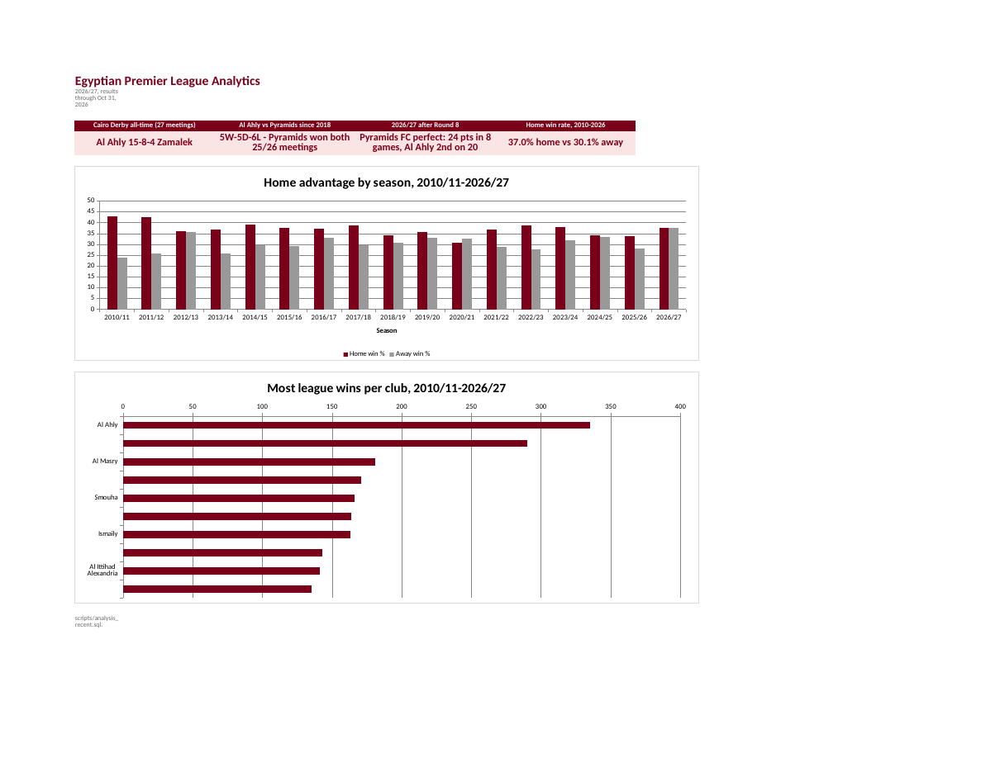

# Egyptian Premier League Analytics (SQL + Excel)

How strong is home advantage in the Egyptian Premier League? Who really owns
the Cairo Derby? And how did Pyramids turn Al Ahly's toughest fixture into a
title race? This project answers all three with 4,486 real match results
across 17 seasons (2010/11-2026/27), SQL queries, and one Excel dashboard.



## What it shows

- **Home advantage by season, 17 seasons**: home teams win ~37% of matches vs
  ~30% for away teams. Two exceptions tell stories: 2012/13, played mostly
  behind closed doors after the Port Said stadium disaster, nearly erased home
  advantage (36.3% vs 35.6%); and 2020/21, the COVID season, posted the lowest
  home win rate on record (30.7%).
- **The Cairo Derby all-time (27 meetings, 2010-today)**: Al Ahly leads
  **15 wins, 8 draws, 4 losses, 47-23 on goals**. Zamalek's last league derby
  win was March 2025 (3-0); Al Ahly has won all three meetings since.
- **Al Ahly vs Pyramids, the new rivalry**: since Pyramids' 2018 rise the
  head-to-head is nearly even - Al Ahly 5W, 5 draws, Pyramids 6W - and
  Pyramids won both 2025/26 meetings (2-0 away, 3-0 at home). Their next
  meeting (Nov 23, 2026) was 1st vs 2nd: Pyramids a perfect 8/8 on 24 points,
  Al Ahly 20.
- **2026/27 league table after Round 8**, computed from raw results with SQL.
- **Most league wins per club, 2010-2026**: Al Ahly 335, Zamalek 290,
  Al Masry 181, Pyramids 171.
- **Top scorer of every season** since 1948/49, from Ahmed Mekkawi to
  Ahmed Yasser Rayyan (2025/26).

## Data sources (all public)

| Data | Source | Link |
|---|---|---|
| Match results 2010/11-2017/18 (2,031 matches) | Public GitHub dataset `EgyptianLeague.csv` | https://github.com/abdelmalek13/Egyptian-League-Analysis |
| Match results 2018/19-2026/27 (2,455 matches, through Oct 31, 2026) | Sofascore public API (tournament 808) | https://www.sofascore.com/tournament/football/egypt/premier-league/808 |
| Top scorer per season 1948/49-2025/26 | English Wikipedia, "Egyptian Premier League" | https://en.wikipedia.org/wiki/Egyptian_Premier_League |

The two match sources overlap on 2017/18 and agreed to the score on every
cross-checked fixture (including both Cairo derbies), so the eras stitch
cleanly. Club names are normalized across eras (e.g. "El Ahly Cairo" and
"Al Ahly FC" both become Al Ahly; Pyramids appear under their pre-2018 name
Alassiouty Sport in the older data).

Note: 2011/12 and 2012/13 were disrupted after the Port Said disaster
(Feb 2012), and 2024/25 used a shortened format with playoffs - season match
counts vary by design. The 2026/27 season is in progress (through Round 8;
the league paused for a November break).

## How it's built

```
scripts/fetch_data.py             downloads and cleans the 2010-2018 datasets
scripts/fetch_recent.py           pulls 2018/19-today from the Sofascore API
scripts/build_recent_dataset.py   merges both eras, normalizes club names
scripts/analysis.sql              original 2010-2017 analysis (5 queries)
scripts/analysis_recent.sql       full-range analysis (6 queries, incl. the
                                  current-season league table)
scripts/build_dashboard.py        runs the SQL over SQLite and writes
                                  Egyptian_Premier_League_Analytics.xlsx
```

To reproduce:

```bash
python3 scripts/fetch_data.py
python3 scripts/fetch_recent.py           # or reuse data/sofascore_raw/
python3 scripts/build_recent_dataset.py
python3 scripts/build_dashboard.py
```

The queries are plain standard SQL (GROUP BY, CASE WHEN, UNION ALL, CTEs,
subqueries) and run unchanged on SQLite; they also work on SQL Server.

## Files

```
Egyptian_Premier_League_Analytics.xlsx   the dashboard (open me first)
data/matches_raw.csv                     original 2010-2018 dataset, unchanged
data/matches_clean.csv                   cleaned 2010-2018 matches
data/matches_2018_2026.csv               the Sofascore extension, cleaned
data/matches_all_2010_2026.csv           both eras combined (4,486 matches)
data/sofascore_raw/*.json                raw API pulls, one file per season
data/top_scorers_by_season.csv           cleaned top scorers table
docs/dashboard_preview.png               screenshot of the dashboard
```
